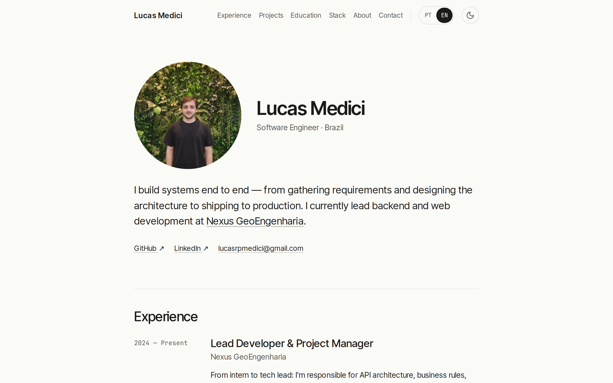
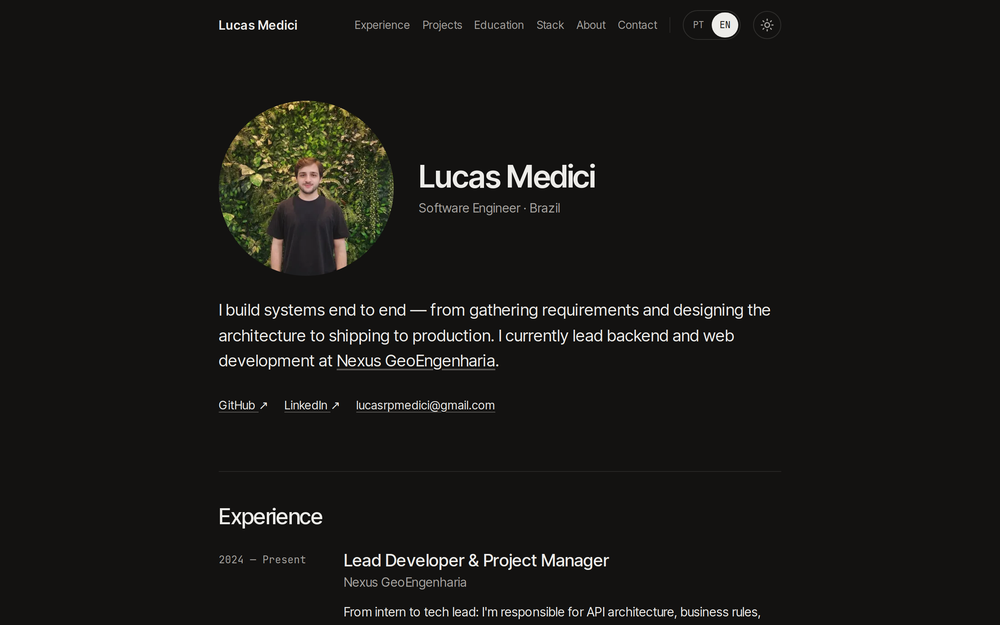

# Lucas Medici — Portfolio

[Português](README.pt-BR.md) · **English**

My personal site: experience, projects, education and stack, in Portuguese and English.

**[lucasmedici.vercel.app](https://lucasmedici.vercel.app)**

<p>
  
  
</p>

## Stack

- [Next.js 16](https://nextjs.org) (App Router) and React 19
- TypeScript
- Tailwind CSS 4
- react-icons and lucide-react for icons
- `next/og` for the share image, Vercel Analytics
- Hosted on [Vercel](https://vercel.com)

## Features

- **Portuguese and English.** The language follows the browser on the first visit and can be switched with the PT | EN toggle; the choice is remembered.
- **Light and dark themes.** The theme follows the system setting and can be switched with the sun/moon button. Both are applied before the first paint, so there's no flash of the wrong theme or language.
- **Responsive.** Same content on desktop and mobile, with a menu for small screens.
- **SEO.** Canonical URL, `robots.txt`, `sitemap.xml`, `Person` JSON-LD and a generated Open Graph image.

## Project structure

```text
src/
├── app/          # layout, page, metadata, robots, sitemap, OG image, global styles
├── components/   # one component per page section (Hero, Experience, Projects…)
├── data/         # all site content (see below)
└── lib/          # theme and language hooks, head scripts, SEO helpers
public/           # profile photo and project screenshots
```

## Editing the content

All text lives in `src/data/`, so content changes don't touch the components:

| File | What it holds |
|---|---|
| `translations.ts` | Interface copy, hero, experience, about and contact, in `pt-br` and `en` |
| `projects.ts` | Projects: image, stack, links, and name and tagline per language |
| `learning.ts` | Degree and courses |
| `skills.ts` | Stack section, grouped by category |
| `profile.ts` | Name, photo, e-mail and social links |

Portuguese is the source text; each entry has its English version next to it.

## Running locally

Requires Node.js 20.9 or later.

```bash
git clone https://github.com/LucasMedici/lucas-medici-portfolio.git
cd lucas-medici-portfolio
npm install
npm run dev
```

Then open [http://localhost:3000](http://localhost:3000).

| Script | What it does |
|---|---|
| `npm run dev` | Development server |
| `npm run build` | Production build |
| `npm run start` | Serves the production build |
| `npm run lint` | ESLint |

## Deploy

Every push to `main` deploys to Vercel; pull requests get a preview URL. Previews are kept out of search engines by `robots.txt`.

The canonical domain defaults to `https://lucasmedici.vercel.app`. To use another domain, set `NEXT_PUBLIC_SITE_URL` in the Vercel project.

## Contact

- [LinkedIn](https://www.linkedin.com/in/lucasmedici)
- [GitHub](https://github.com/LucasMedici)
- lucasrpmedici@gmail.com

---

© Lucas Medici. All rights reserved. The source is public for reference; the content, photos and screenshots are mine.
