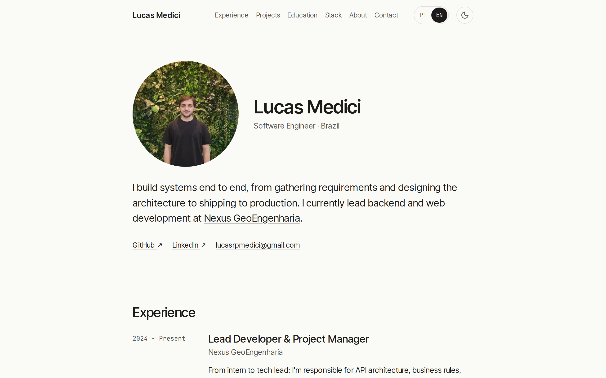
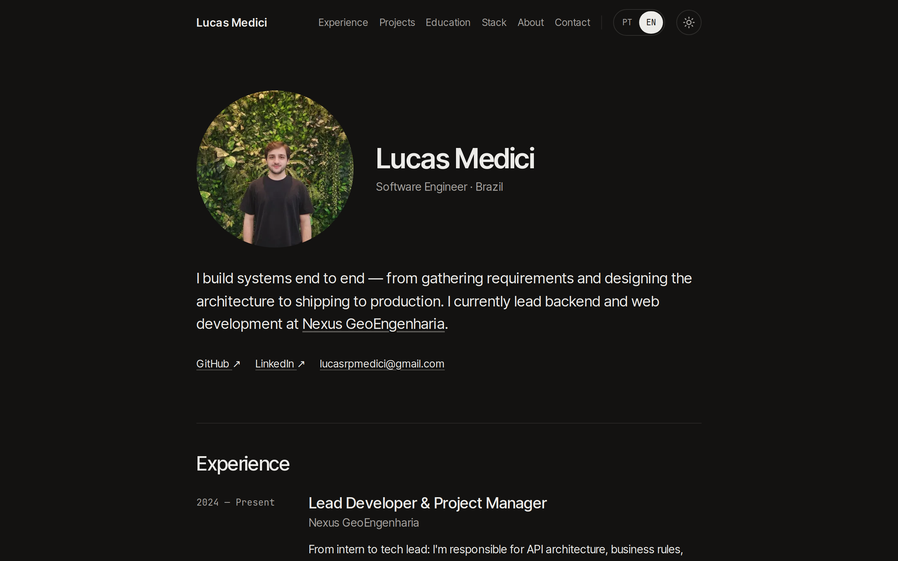

# Lucas Medici · Portfólio

**Português** · [English](README.md)

Meu site pessoal: experiência, projetos, formação e stack, em português e inglês.

**[lucasmedici.vercel.app](https://lucasmedici.vercel.app)**

<p>
  
  
</p>

## Stack

- [Next.js 16](https://nextjs.org) (App Router) e React 19
- TypeScript
- Tailwind CSS 4
- react-icons e lucide-react para os ícones
- `next/og` para a imagem de compartilhamento, Vercel Analytics
- Hospedado na [Vercel](https://vercel.com)

## Recursos

- **Português e inglês.** O idioma segue o navegador na primeira visita e pode ser trocado no botão PT | EN; a escolha fica salva.
- **Tema claro e escuro.** O tema segue a configuração do sistema e pode ser trocado no botão de sol/lua. Os dois são aplicados antes da primeira pintura, então a página não pisca no tema ou idioma errado.
- **Responsivo.** O mesmo conteúdo no desktop e no celular, com menu para telas pequenas.
- **SEO.** URL canônica, `robots.txt`, `sitemap.xml`, JSON-LD de `Person` e imagem de Open Graph gerada no build.

## Estrutura do projeto

```text
src/
├── app/          # layout, página, metadados, robots, sitemap, imagem OG, estilos globais
├── components/   # um componente por seção da página (Hero, Experience, Projects…)
├── data/         # todo o conteúdo do site (veja abaixo)
└── lib/          # hooks de tema e idioma, scripts do <head>, helpers de SEO
public/           # foto de perfil e prints dos projetos
```

## Editando o conteúdo

Todo o texto fica em `src/data/`, então mudar conteúdo não mexe nos componentes:

| Arquivo | O que tem |
|---|---|
| `translations.ts` | Textos da interface, hero, experiência, sobre e contato, em `pt-br` e `en` |
| `projects.ts` | Projetos: imagem, stack, links e nome e descrição por idioma |
| `learning.ts` | Graduação e cursos |
| `skills.ts` | Seção de stack, agrupada por categoria |
| `profile.ts` | Nome, foto, e-mail e redes sociais |

O português é o texto de origem; cada item tem a versão em inglês ao lado.

## Rodando localmente

Precisa do Node.js 20.9 ou mais recente.

```bash
git clone https://github.com/LucasMedici/lucas-medici-portfolio.git
cd lucas-medici-portfolio
npm install
npm run dev
```

Depois é só abrir [http://localhost:3000](http://localhost:3000).

| Script | O que faz |
|---|---|
| `npm run dev` | Servidor de desenvolvimento |
| `npm run build` | Build de produção |
| `npm run start` | Serve o build de produção |
| `npm run lint` | ESLint |

## Deploy

Cada push na `main` faz deploy na Vercel; pull requests ganham uma URL de preview. Os previews ficam fora dos buscadores pelo `robots.txt`.

O domínio canônico padrão é `https://lucasmedici.vercel.app`. Para usar outro domínio, defina `NEXT_PUBLIC_SITE_URL` no projeto da Vercel.

## Contato

- [LinkedIn](https://www.linkedin.com/in/lucasmedici)
- [GitHub](https://github.com/LucasMedici)
- lucasrpmedici@gmail.com

---

© Lucas Medici. Todos os direitos reservados. O código é público para consulta; o conteúdo, as fotos e os prints são meus.
